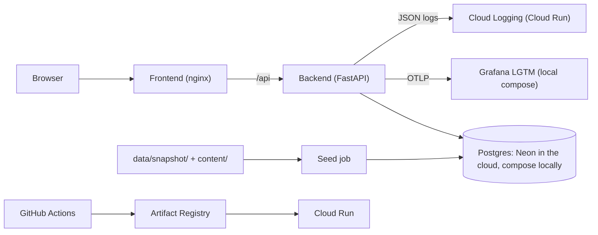

# CLIO Findings Explorer

CLIO Findings Explorer is a public archive that helps journalists, researchers and civil-society readers check what CLIO's data shows about civil-liberties pressure in Kenya in specific weeks, and what it does not. It presents five curated findings from a committed snapshot of CLIO output, each with its regime state, a plain-language summary, evidence from ACLED, OONI and the Google Transparency Report, and a limits box.

This is the final project for AI Dev Tools Zoomcamp 2026.

## Live site

| Environment | URL |
|---|---|
| Production | <https://cfe-frontend-prod-qf6bvfuxjq-ew.a.run.app> |
| Dev | <https://cfe-frontend-dev-qf6bvfuxjq-ew.a.run.app> |

<picture><source media="(prefers-color-scheme: dark)" srcset="docs/images/ledger-dark.png"></picture>

*The landing page: 1,523 classified weeks drawn as a ledger, with the five findings outlined.*

## The problem

When a government restricts civil liberties, the evidence arrives in pieces with different grains. Conflict-event records (ACLED) describe what happened on the street, network measurements (OONI) describe what happened to internet access, and platform transparency reports (Google) describe what content governments asked to have removed. Each has its own collection method and reliability.

A reader who wants to know whether there was coordinated pressure in a particular week has two options today: correlate three raw datasets by hand, or trust a summary with nothing traceable underneath. This project gives a third: a small set of weeks, each shown with its evidence and a statement of what that evidence does not establish. Details are in [product-spec.md](product-spec.md) §1 and §4.

## What it does

The app is read-only and never queries CLIO or BigQuery at runtime. Every number comes from the snapshot in `data/snapshot/`.

- **Ledger (`/`)**: every classified week as one cell, one row per year, coloured by regime state. Weeks with insufficient data are pale. Weeks with a finding are outlined and reachable by keyboard.
- **Finding page (`/findings/:slug`)**: state and confidence, the week's three family bands, a context strip of the 13 weeks either side, three exhibits (A: ACLED, B: OONI, C: Google), a limits box, and the public sources for real-world statements. An exhibit with no data for the week is still shown and says so.
- **Register (`/findings`)**, **methodology (`/methodology`)** and **about (`/about`)**: the list of findings, how CLIO classifies a week, and what the sources and the project are. Light and dark themes.

<picture><source media="(prefers-color-scheme: dark)" srcset="docs/images/finding-dark.png"></picture>

<picture><source media="(prefers-color-scheme: dark)" srcset="docs/images/finding-phone-dark.png"></picture>

| Week | Finding |
|---|---|
| 22–28 June 2024 | [Protest and suppression both SEVERE](content/findings/finance-bill-2024.yaml): CLIO's first CRISIS week of the 2024 Finance Bill protests. |
| 21–27 June 2025 | [STABLE, with Telegram far above its baseline](content/findings/june-july-2025.yaml): a limits case: suppression was raised, but entering REPRESSION needs two consecutive qualifying weeks. |
| 15–21 July 2023 | [CRISIS, with OONI signals flat](content/findings/july-2023.yaml): the week the opposition began three days of protests. |
| 6–12 August 2022 | [Suppression and violence SEVERE in the election week](content/findings/general-election-2022.yaml): a CRISIS label computed only from ACLED offline events. |
| 19–25 January 2008 | [The first week CLIO could score after the disputed election](content/findings/post-election-violence-2008.yaml): a limits case, where the busiest ACLED week around the election read "STABLE (insufficient data)". |

The snapshot (`2026-10-10.1`) holds 1,523 Kenya weeks, whose start dates run from 11 January 1997 to 14 March 2026 (the last week ends 20 March 2026). 961 of them are STABLE with insufficient data. It also holds 85 ACLED context rows, 550 OONI rows and 85 Google rows, plus 5 findings with 21 caveats in total.

## Does it work?

### Evidence review

Every finding was checked claim by claim by the [`evidence-reviewer`](.claude/agents/evidence-reviewer.md) subagent, which can only query the snapshot and read files. It gives each assertion a verdict: VERIFIED (the snapshot establishes it), CORRECTED, UNSUPPORTED (including any claim about cause or intent), or EXTERNAL (a real-world or CLIO-rule statement, which needs a cited source). A finding is published only with no UNSUPPORTED or CORRECTED row and no EXTERNAL row without a source. Counts below are from each log's verdict table.

| Finding | Assertions | VERIFIED | CORRECTED | UNSUPPORTED | EXTERNAL | Log |
|---|---|---|---|---|---|---|
| finance-bill-2024 | 26 | 17 | 0 | 0 | 9 | [log](docs/reviews/finance-bill-2024.md) |
| general-election-2022 | 35 | 23 | 0 | 0 | 12 | [log](docs/reviews/general-election-2022.md) |
| july-2023 | 35 | 24 | 0 | 0 | 11 | [log](docs/reviews/july-2023.md) |
| june-july-2025 | 39 | 28 | 0 | 0 | 11 | [log](docs/reviews/june-july-2025.md) |
| post-election-violence-2008 | 52 | 35 | 0 | 0 | 17 | [log](docs/reviews/post-election-violence-2008.md) |

One mismatch: the reviewer's own summary line in the finance-bill-2024 log says 15 VERIFIED and 11 EXTERNAL, but its 26-row table has 17 and 9. The table is unedited and its count is used here; the log notes the difference. The other four summary lines match their tables.

### Tests

One command runs every suite (needs the compose database running and seeded, and says so if it is not):

```bash
scripts/test-all.sh
```

| Suite | Tests | Covers |
|---|---|---|
| Hook tests | 74 | The git guard and the spec-first guard |
| Snapshot export and on-call receiver tests | 78 | The export, including that it refuses any synthetic-flagged table (fake BigQuery, fixtures only) |
| Backend unit | 132 | Evidence functions, content language check, schemas; no database |
| Backend integration | 80 | Real Postgres 16 with the real snapshot; every response validated against `openapi.yaml` |
| MCP server | 54 | `spec_lookup` and the read-only `query_snapshot` tool |
| Frontend | 103 | Vitest and Testing Library; also checks that only `client.ts` calls `fetch` |

That is 521 tests in a full run. CI runs the same suites as separate jobs on every push to `main` and every pull request, so `scripts/test-all.sh` is not part of CI. See [docs/ci.md](docs/ci.md).

### Monitoring

The backend emits OpenTelemetry traces (one per request, with database spans), metrics per route template and structured JSON logs that carry the trace ID. `docker compose up -d` starts a local Grafana at <http://127.0.0.1:3000> with a provisioned "Finding-page journey" dashboard; on Cloud Run the same logs go to Cloud Logging with the trace ID. What is collected, what never is, and how to move between a log line and its trace are in [docs/observability.md](docs/observability.md) ([#5](https://github.com/Sanjomwa/clio-findings-explorer/issues/5)).

A provisioned Grafana alert rule pages a webhook when, over 5 minutes with at least 10 requests, more than 5% of `/api/findings/*` requests return 5xx or their p95 latency exceeds 2 s. `ops/alerting/trigger-db-down.sh` fires it on purpose by stopping the database. The numbers, the recorded run and the webhook payload are in [docs/alerting.md](docs/alerting.md) ([#6](https://github.com/Sanjomwa/clio-findings-explorer/issues/6)).

The webhook is received by a small `oncall` service, which writes each alert to a git-ignored inbox folder; the page now lands somewhere, and the delivery shows as successful in Grafana. Still in progress: the on-call agent that reads the inbox, fixes the fault and writes the incident report ([#7](https://github.com/Sanjomwa/clio-findings-explorer/issues/7), Part B). Nothing fixes anything yet. The design, the wake-up demo and the plan are in [docs/on-call.md](docs/on-call.md) and [product-spec.md](product-spec.md) §7.4.

## Run it locally

Prerequisites: Docker with Docker Compose. Node 22 and [uv](https://docs.astral.sh/uv/) are needed only to run tests outside Docker.

```bash
cp .env.example .env              # skip if you already have a .env
docker compose up -d --build      # starts Postgres, loads the snapshot, starts the API and the app
curl -s localhost:8000/api/health
```

The app is at <http://localhost:8080>; the API stays on `127.0.0.1:8000`. Expected health result (key fields):

```json
{"status": "ok", "database": "reachable", "snapshot_version": "2026-10-10.1", "migration_head": "0004",
 "row_counts": {"regime_weeks": 1523, "acled_signal_context": 85, "ooni_weekly_signals": 550,
                "google_transparency_requests": 85, "findings": 5, "finding_caveats": 21}}
```

`.env.example` holds local-only placeholders for a throwaway Postgres container (user, password, database name). Nothing in it is secret, and no cloud credentials ever go there.

**The data.** The snapshot in `data/snapshot/` is committed. [`MANIFEST.json`](data/snapshot/MANIFEST.json) records, per file, the source table, the exact SQL, the row count, a sha256 checksum and the export time. Licence terms are in [data/README.md](data/README.md).

**Troubleshooting**

- `curl` prints nothing right after compose returns: the API can take a few seconds to start. Run it again.
- Port 5432 is already in use: compose does not use it. The database is published on `127.0.0.1:55432`, so a local Postgres on 5432 does not clash.
- The first image build stalls while downloading Python packages (seen once, in `uv sync`): stop it and run the build again.

For backend and frontend details see [backend/README.md](backend/README.md) and [frontend/README.md](frontend/README.md). The full command list is in [AGENTS.md](AGENTS.md).

## Deployment and CI/CD

- **Hosting:** Google Cloud Run in `europe-west1` and Neon Postgres on AWS `eu-central-1`, with one Neon branch per environment. Services scale to zero.
- **Dev:** every push to `main` runs CI; when it passes, [`deploy.yml`](.github/workflows/deploy.yml) builds both images, runs the seed job, deploys and smoke-tests `/api/health`. A red CI deploys nothing. The first deploy was commit `c5ce7f8`: Deploy #1 to dev ran automatically, and Deploy #2 promoted it to production. Deploy #3 (commit `fa43623`, run 39063387329) also ran automatically to dev, and passed its smoke test.
- **Production:** a manual "Promote to production" run behind a GitHub environment that needs Sam's approval. It reuses the images dev already ran and never rebuilds.
- **Rollback:** route traffic back to the previous Cloud Run revision (commands in [docs/deploy.md](docs/deploy.md)). A rollback was rehearsed on dev on 17 October 2026: traffic was moved to the previous revision of both services, the health check passed, then traffic was moved back to the latest ([record](docs/deploy.md#rollback-tried-on-dev)).
- **One-time setup** (Neon, Cloud Shell script, GitHub variables and environments) is in [docs/deploy.md](docs/deploy.md). Authentication is Workload Identity Federation; there are no key files.

CI ([`ci.yml`](.github/workflows/ci.yml), [docs/ci.md](docs/ci.md)) runs seven jobs: ruff lint; OpenAPI 3.1 validation of `openapi.yaml`; hook and export tests; backend unit tests; integration tests plus the MCP tests against Postgres; frontend checks (generated API types match the contract, typecheck, lint, tests, build); and a compose smoke test of the whole stack.

## Architecture



- **Frontend:** React and TypeScript, built to static files and served by nginx, which also proxies `/api` to the backend. All HTTP goes through one client.
- **Backend:** FastAPI with eight read-only endpoints defined by `openapi.yaml`. Evidence cards are computed per request from the snapshot tables.
- **Database:** Postgres 16. The schema is Alembic migrations; a database constraint rejects a finding with no caveat.
- **Seed:** verifies the snapshot's checksums, then loads `data/snapshot/` and `content/` (the human-written content). It is safe to run on every deploy.
- **CI/CD:** GitHub Actions builds images into Artifact Registry and deploys them to Cloud Run.
- **Observability:** the backend sends traces and metrics over OTLP to a local Grafana LGTM container, and writes JSON logs with the trace ID that Cloud Run sends to Cloud Logging. See [docs/observability.md](docs/observability.md).

## How it was built: the agent team and process

| Who | Role |
|---|---|
| Sam | Reviews, commits, pushes, deploys; the only person who runs the BigQuery export |
| Planning and review session | Writes the task prompts and reviews reports; has no access to this filesystem |
| Claude Code | Writes code, tests and docs, and reports; never commits |
| `evidence-reviewer` subagent | Read-only claim-by-claim checker of finding drafts |

Tools and guards: [`/new-finding`](.claude/commands/new-finding.md) is the only way to add a finding; the MCP server's `spec_lookup` and `query_snapshot` tools ([mcp-server/README.md](mcp-server/README.md)); and two hooks ([agent-hooks/README.md](agent-hooks/README.md)): `block-autonomous-git` blocks git writes and `spec-first-guard` blocks a route that is not in `openapi.yaml`.

Work flows: issue → prompt → Claude Code report → review → Sam's commit. Each agent reads its issue first and comments on it when done.

- Rules: [AGENTS.md](AGENTS.md), [docs/permissions.md](docs/permissions.md)
- Record of every AI-assisted task: [docs/ai-workflow-log.md](docs/ai-workflow-log.md)
- Tracker: [GitHub Issues](https://github.com/Sanjomwa/clio-findings-explorer/issues)

`docs/agent-team.md` is in progress ([#8](https://github.com/Sanjomwa/clio-findings-explorer/issues/8)).

## Decisions and trade-offs

- **A committed snapshot over live BigQuery queries.** Anyone can run the app with no credentials, and every number traces to a file with a checksum. The downside is that the data is fixed in time. Accepted because this is an archive of curated weeks, not a monitor, and the app says so.
- **A hand-written `openapi.yaml` before the code over generating it from the code.** The contract is reviewed on its own, and CI fails if the generated frontend types drift from it. The downside is that every API change is two steps. Accepted because the `spec-first-guard` hook and the contract tests make the second step checkable.
- **Self-hosted fonts over a font CDN.** No request goes to a third-party host. The downside is a larger build. Accepted because the site then makes no call a reader did not ask for.
- **Cloud Run and Neon over a single always-on host.** Both scale to zero, so idle cost is close to nothing, and the regions (`europe-west1` and `eu-central-1`) are both in Europe. The downside is a cold start of a few seconds for the first visitor. Accepted for a low-traffic archive.
- **A deny-list of causal words plus claim-by-claim review over free-written summaries.** A test rejects a fixed list of cause-and-intent phrases in `content/`, and the reviewer checks each remaining assertion. The downside is that the reviewer is an LLM and not fully consistent (see Limitations). Accepted because every verdict is logged and a human reads it before publishing.

## Project structure

```
backend/            FastAPI app, Alembic migrations, seed, tests
frontend/           React app, nginx config, Dockerfile
data/snapshot/      Committed CLIO snapshot and MANIFEST.json
content/            Findings and methodology text written by people
openapi.yaml        The API contract
docker-compose.yml  db, seed, backend, frontend
scripts/            test-all.sh, the single test command
ops/                Snapshot export, deploy scripts, screenshot script
mcp-server/         The read-only MCP tools
agent-hooks/        The git guard and spec-first guard
.claude/            The evidence-reviewer subagent and /new-finding
custom-agent/       Source copy of the evidence-reviewer
docs/               Deploy, CI, permissions, review logs, workflow log, images
.github/workflows/  ci.yml and deploy.yml
```

## Limitations

- **Kenya only, fixed in time.** Weeks start from 11 January 1997 to 14 March 2026. The app does not update, so it says nothing about later weeks.
- **961 of 1,523 weeks are STABLE with insufficient data.** For those weeks a STABLE label means CLIO had too little data, not that things were calm.
- **ACLED is the classifier's own input.** The ACLED card is not independent confirmation of CLIO's label.
- **Narrow source windows.** The OONI rows run from 27 May 2023 to 28 June 2025, so earlier findings show no OONI data. Google data is half-yearly, so its card shows a half-year, not a week.
- **The reviewer is an LLM and was inconsistent across runs.** It gave a summary line that did not match its own table, and wrote a nonstandard verdict text in seven rows, which the clean-review test rejected ([docs/ai-workflow-log.md](docs/ai-workflow-log.md), 15 October 2026). A format rule was added afterwards.
- **No automated traceability test yet.** That every number on a finding page equals a snapshot value is checked by the reviewer and by tests of the evidence functions, not by a test that recomputes each card ([#13](https://github.com/Sanjomwa/clio-findings-explorer/issues/13)).
- **Cloud Run's platform logs record caller IP addresses.** The nginx access log does not, but the platform's cannot be switched off ([docs/deploy.md](docs/deploy.md)).
- **No on-call agent yet** ([#7](https://github.com/Sanjomwa/clio-findings-explorer/issues/7)); the alert's webhook delivery fails until it exists.
- **The alert does not see a stopped backend.** A backend that is down emits no metrics, so the rule sees no data and stays Normal ([docs/alerting.md](docs/alerting.md)).

## Future work

Open issues, in priority order:

1. The on-call agent ([#7](https://github.com/Sanjomwa/clio-findings-explorer/issues/7)).
2. The agent team specification and modular docs for `AGENTS.md` ([#8](https://github.com/Sanjomwa/clio-findings-explorer/issues/8), [#9](https://github.com/Sanjomwa/clio-findings-explorer/issues/9)).
3. The traceability test ([#13](https://github.com/Sanjomwa/clio-findings-explorer/issues/13)).
4. Reviewer consistency fixes and two finding re-runs ([#10](https://github.com/Sanjomwa/clio-findings-explorer/issues/10)), and small fixes ([#11](https://github.com/Sanjomwa/clio-findings-explorer/issues/11)).
5. The final README pass and a clean-clone check ([#12](https://github.com/Sanjomwa/clio-findings-explorer/issues/12)).
6. Shift-left security checks: ruff `S` rules, CodeQL, dependency audit and injection tests ([#14](https://github.com/Sanjomwa/clio-findings-explorer/issues/14)).

## Self-evaluation

Against the [course rubric](https://github.com/DataTalksClub/ai-dev-tools-zoomcamp/blob/main/project/README.md): 12 criteria, 24 points, pass mark 10. Points are claimed only where the evidence exists today.

| Criterion | Max | Claimed | Evidence |
|---|---|---|---|
| Problem description | 2 | 2 | This README: [the problem](#the-problem), [what it does](#what-it-does); [product-spec.md](product-spec.md) §1, §4 |
| Product specification | 2 | 2 | [product-spec.md](product-spec.md) with acceptance criteria in §9; [public tracker](https://github.com/Sanjomwa/clio-findings-explorer/issues) with agent comments, e.g. [#1](https://github.com/Sanjomwa/clio-findings-explorer/issues/1) and [#2](https://github.com/Sanjomwa/clio-findings-explorer/issues/2) |
| Agent team specification | 2 | 1 | Roles in [How it was built](#how-it-was-built-the-agent-team-and-process), [AGENTS.md](AGENTS.md), [docs/permissions.md](docs/permissions.md). `docs/agent-team.md` is in progress ([#8](https://github.com/Sanjomwa/clio-findings-explorer/issues/8)) |
| Context management | 2 | 1 | [AGENTS.md](AGENTS.md) describes the project. Modular docs are in progress ([#9](https://github.com/Sanjomwa/clio-findings-explorer/issues/9)) |
| Application | 2 | 2 | [Run it locally](#run-it-locally); frontend, backend and Postgres work end to end with one command |
| Testing | 2 | 2 | [Tests](#tests): unit and integration, `scripts/test-all.sh`, 521 passing |
| Containerization | 2 | 2 | [docker-compose.yml](docker-compose.yml): db, seed, backend, frontend and the local Grafana stack with one command |
| Deployment | 2 | 2 | [Live site](#live-site); [docs/deploy.md](docs/deploy.md) |
| CI/CD | 3 | 3 | CI tests, automatic deploy to dev, manual promotion to production: [ci.yml](.github/workflows/ci.yml), [deploy.yml](.github/workflows/deploy.yml), [docs/deploy.md](docs/deploy.md) |
| Observability | 2 | 2 | [docs/observability.md](docs/observability.md); provisioned dashboard [finding-journey.json](ops/grafana/dashboards/finding-journey.json); privacy and trace-ID tests in [test_telemetry.py](backend/tests/unit/test_telemetry.py) and [test_telemetry_db.py](backend/tests/integration/test_telemetry_db.py); Cloud Logging trace fields on Cloud Run |
| Alerting on user impact | 1 | 1 | Provisioned rule on 5xx share and p95 latency: [docs/alerting.md](docs/alerting.md), [rules.yaml](ops/grafana/provisioning/alerting/rules.yaml), [test_alert_rules.py](backend/tests/unit/test_alert_rules.py); fired on purpose with [trigger-db-down.sh](ops/alerting/trigger-db-down.sh) |
| On-call agent | 2 | 0 | In progress ([#7](https://github.com/Sanjomwa/clio-findings-explorer/issues/7)) |
| **Total** | **24** | **20** | |

## Data and licence

MIT. See [LICENSE](LICENSE).

The data in `data/snapshot/` is third-party derived data under its sources' own terms, not MIT: see [data/README.md](data/README.md).
