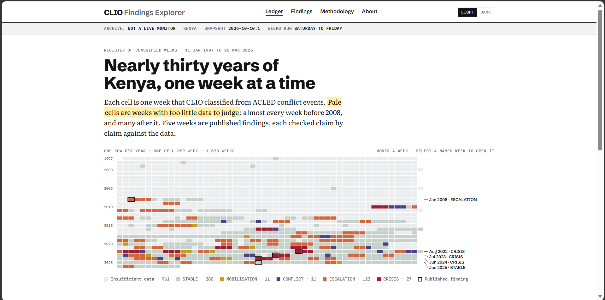
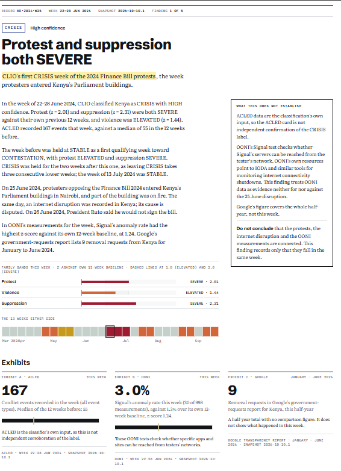
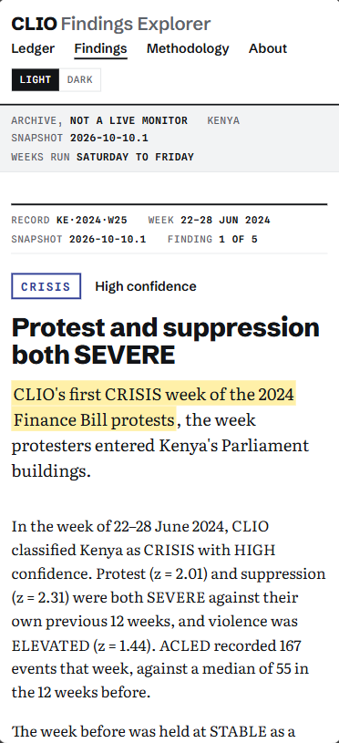
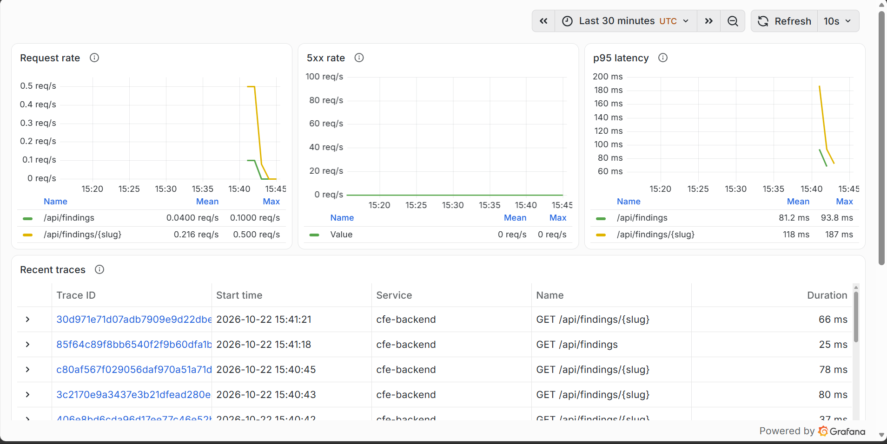
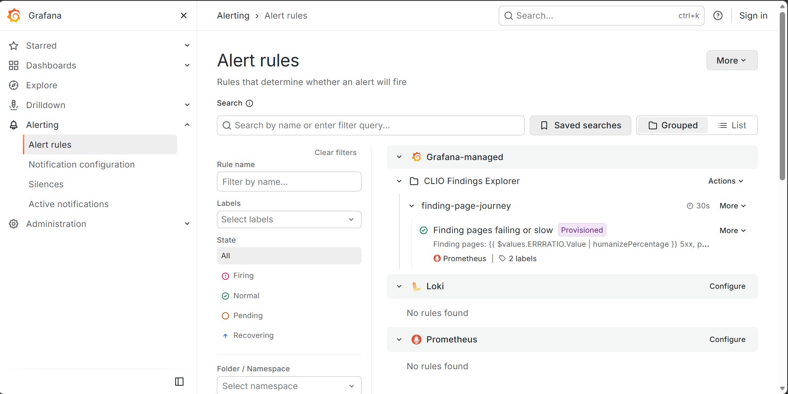
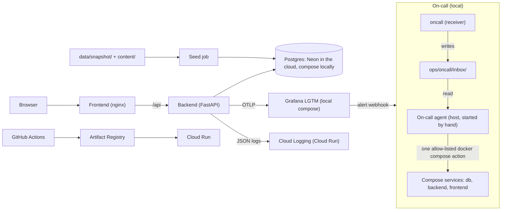

# CLIO Findings Explorer

[](https://github.com/Sanjomwa/clio-findings-explorer/actions/workflows/ci.yml)

CLIO Findings Explorer is a public archive that helps journalists, researchers and civil-society readers check what data from CLIO (Civil Liberties Intelligence Observatory) shows about civil-liberties pressure in Kenya in specific weeks, and what it does not. CLIO scores pressure families from ACLED conflict events each week and assigns one of seven regime states; the app adds OONI network measurements and Google takedown requests as evidence. It presents five curated findings from a committed snapshot of CLIO output, each with its regime state, a plain-language summary, evidence from ACLED, OONI and the Google Transparency Report, and a limits box.

This is the final project for AI Dev Tools Zoomcamp 2026.

## Live site

| Environment | URL |
|---|---|
| Production | <https://cfe-frontend-prod-qf6bvfuxjq-ew.a.run.app> |
| Dev | <https://cfe-frontend-dev-qf6bvfuxjq-ew.a.run.app> |

Reviewing this project? Try the 2-minute [reader test](docs/reader-test.md) and record your answers with the Reader test issue template.



*The landing page: 1,523 classified weeks drawn as a ledger, with the five findings outlined.*

## The problem

When a government restricts civil liberties, the evidence arrives in pieces with different grains. Conflict-event records (ACLED) describe what happened on the street, network measurements (OONI) describe what happened to internet access, and platform transparency reports (Google) describe what content governments asked to have removed. Each has its own collection method and reliability.

A reader who wants to know whether there was coordinated pressure in a particular week has two options today: correlate three raw datasets by hand, or trust a summary with nothing traceable underneath. This project gives a third: a small set of weeks, each shown with its evidence and a statement of what that evidence does not establish. Details are in [product-spec.md](product-spec.md) §1 and §4.

## What it does

The app is read-only and never queries CLIO or BigQuery at runtime. Every number comes from the snapshot in `data/snapshot/`.

- **Ledger (`/`)**: every classified week as one cell, one row per year, coloured by regime state. Weeks with insufficient data are pale. Weeks with a finding are outlined and reachable by keyboard.
- **Finding page (`/findings/:slug`)**: state and confidence, the week's three family bands, a context strip of the 13 weeks either side, three exhibits (A: ACLED, B: OONI, C: Google), a limits box, and the public sources for real-world statements. An exhibit with no data for the week is still shown and says so.
- **Register (`/findings`)**, **methodology (`/methodology`)** and **about (`/about`)**: the list of findings, how CLIO classifies a week, and what the sources and the project are. Light and dark themes.





| Week | Finding |
|---|---|
| 22–28 June 2024 | [Protest and suppression both SEVERE](content/findings/finance-bill-2024.yaml): CLIO's first CRISIS week of the 2024 Finance Bill protests. |
| 21–27 June 2025 | [STABLE, with Telegram far above its baseline](content/findings/june-july-2025.yaml): a limits case: suppression was raised, but entering REPRESSION needs two consecutive qualifying weeks. |
| 15–21 July 2023 | [CRISIS, with OONI signals flat](content/findings/july-2023.yaml): the week the opposition began three days of protests. |
| 6–12 August 2022 | [Suppression and violence SEVERE in the election week](content/findings/general-election-2022.yaml): a CRISIS label computed only from ACLED offline events. |
| 19–25 January 2008 | [The first week CLIO could score after the disputed election](content/findings/post-election-violence-2008.yaml): a limits case, where the busiest ACLED week around the election read "STABLE (insufficient data)". |

The snapshot (`2026-10-10.1`) holds 1,523 Kenya weeks, whose start dates run from 11 January 1997 to 14 March 2026 (the last week ends 20 March 2026). 961 of them are STABLE with insufficient data. It also holds 85 ACLED context rows, 550 OONI rows and 85 Google rows, plus 5 findings with 21 caveats in total.

## Does it work?

### Evidence review

Every finding was checked claim by claim by the [`evidence-reviewer`](.claude/agents/evidence-reviewer.md) subagent, which can only query the snapshot and read files. It gives each assertion a verdict: VERIFIED (the snapshot establishes it), CORRECTED, UNSUPPORTED (including any claim about cause or intent), or EXTERNAL (a real-world or CLIO-rule statement, which needs a cited source). A finding is published only with no UNSUPPORTED or CORRECTED row and no EXTERNAL row without a source. Counts below are from each log's verdict table.

| Finding | Assertions | VERIFIED | CORRECTED | UNSUPPORTED | EXTERNAL | Log |
|---|---|---|---|---|---|---|
| finance-bill-2024 | 26 | 17 | 0 | 0 | 9 | [log](docs/reviews/finance-bill-2024.md) |
| general-election-2022 | 35 | 23 | 0 | 0 | 12 | [log](docs/reviews/general-election-2022.md) |
| july-2023 | 35 | 24 | 0 | 0 | 11 | [log](docs/reviews/july-2023.md) |
| june-july-2025 | 39 | 28 | 0 | 0 | 11 | [log](docs/reviews/june-july-2025.md) |
| post-election-violence-2008 | 52 | 35 | 0 | 0 | 17 | [log](docs/reviews/post-election-violence-2008.md) |

One mismatch: the reviewer's own summary line in the finance-bill-2024 log says 15 VERIFIED and 11 EXTERNAL, but its 26-row table has 17 and 9. The table is unedited and its count is used here; the log notes the difference. The other four summary lines match their tables. Each published log now also carries a script-computed `Counted:` line under the reviewer's own summary line (added 25 October 2026; the review itself is unchanged), and a test requires that line in every published log and checks it against the table. The reviewer's summary line is kept as written, so finance-bill-2024 still shows its original 15 and 11.

To rerun the review for a finding, start Claude Code from the repository root with the compose stack up and seeded (`docker compose up -d --build`) and a human-written `content/drafts/<slug>.yaml`, then type `/new-finding <slug>`. It needs the database (through the MCP server's `query_snapshot`) and the `evidence-reviewer` subagent, re-reviews the draft and overwrites `docs/reviews/<slug>.md`. A finding that already exists in `content/findings/` makes the command stop at its first step. Then `uv run --directory backend pytest tests/unit/test_content_language.py tests/unit/test_content_reviewed.py -v` checks the language rules and that every finding has a clean log ([agent-capabilities/README.md](agent-capabilities/README.md)). After the first runs, the reviewer's output format got a rule (one verdict word per row, and the counts in the summary line must match the table) because of the nonstandard verdict text and the mismatched summary line; see [docs/ai-workflow-log.md](docs/ai-workflow-log.md).

### Tests

One command runs every suite (needs the compose database running and seeded, and says so if it is not):

```bash
scripts/test-all.sh
```

| Suite | Tests | Covers |
|---|---|---|
| Hook tests | 82 | The git guard and the spec-first guard |
| Snapshot export, on-call receiver, on-call actor and docs-link tests | 142 | The export, including that it refuses any synthetic-flagged table (fake BigQuery, fixtures only); the webhook receiver; the on-call actor's guards, gates and escalation, with fake `claude`, `docker` and `gh` (no Docker, no model, no network); that every relative link in `AGENTS.md`, `README.md` and `docs/*.md` resolves and every doc is linked from `AGENTS.md` |
| Backend unit | 150 | Evidence functions, content language check, schemas, and that every published review log carries a `Counted:` line equal to its table; no database |
| Backend integration | 139 | Real Postgres 16 with the real snapshot; every response validated against `openapi.yaml`; a traceability test that recomputes every evidence-card number from the snapshot files; and injection strings sent to the slug, country, date and state parameters get 422 or 404, never 500, with row counts unchanged |
| MCP server | 54 | `spec_lookup` and the read-only `query_snapshot` tool |
| Frontend | 104 | Vitest and Testing Library; also checks that only `client.ts` calls `fetch` |

That is 671 tests, and all six suites passed in one run of `scripts/test-all.sh` on the submitted code on 25 October 2026. CI runs the same suites as separate jobs on every push to `main` and every pull request ([CI runs](https://github.com/Sanjomwa/clio-findings-explorer/actions/workflows/ci.yml)), so `scripts/test-all.sh` is not part of CI. See [docs/ci.md](docs/ci.md).

### Monitoring

The backend emits OpenTelemetry traces (one per request, with database spans), metrics per route template and structured JSON logs that carry the trace ID. `docker compose up -d` starts a local Grafana at <http://127.0.0.1:3000> with a provisioned "Finding-page journey" dashboard; on Cloud Run the same logs go to Cloud Logging with the trace ID. What is collected, what never is, and how to move between a log line and its trace are in [docs/observability.md](docs/observability.md) ([#5](https://github.com/Sanjomwa/clio-findings-explorer/issues/5)).



*The "Finding-page journey" dashboard on the local Grafana after about 100 requests: request rate, 5xx rate and p95 latency per route, and the most recent traces.*

A provisioned Grafana alert rule pages a webhook when, over 5 minutes with at least 10 requests, more than 5% of `/api/findings/*` requests return 5xx or their p95 latency exceeds 2 s. `ops/alerting/trigger-db-down.sh` fires it on purpose by stopping the database. The numbers, the recorded run and the webhook payload are in [docs/alerting.md](docs/alerting.md) ([#6](https://github.com/Sanjomwa/clio-findings-explorer/issues/6)).



*The provisioned rule "Finding pages failing or slow" in Grafana's alert rule list, in the Normal state (the green tick) during normal traffic.*

The webhook is received by a small `oncall` service, which writes each alert to a git-ignored inbox folder. The on-call agent ([`ops/oncall/actor.py`](ops/oncall/actor.py), [#7](https://github.com/Sanjomwa/clio-findings-explorer/issues/7)) is started by hand, reads that inbox, collects evidence, asks one pinned model (Claude Sonnet 5.5, read-only tools) for a diagnosis, and, if the answer passes validation, runs one allow-listed `docker compose start` or `restart`. It counts the fix only if the service is healthy, a replay of the failing request passes, a fast test suite passes and the alert returns to Normal; otherwise it escalates with a GitHub issue labelled `incident`. Every incident gets a report folder in `docs/incidents/`. Usage guards (cooldown, call budgets, a kill switch) are described with the recorded end-to-end run, where the agent restarted a stopped database with no human step, in [docs/on-call.md](docs/on-call.md) ([incident report](docs/incidents/20261021T071101Z-1ee17afeb9fa5762/summary.md)).

## Run it locally

Prerequisites: Docker with Docker Compose. Python 3.12, Node 22 and [uv](https://docs.astral.sh/uv/) are needed only to run tests outside Docker.

```bash
git clone https://github.com/Sanjomwa/clio-findings-explorer.git
cd clio-findings-explorer
cp .env.example .env              # skip if you already have a .env
docker compose up -d --build      # starts Postgres, loads the snapshot, starts the API and the app
curl -s localhost:8000/api/health
```

The app is at <http://localhost:8080>; the API stays on `127.0.0.1:8000`. Expected health result (key fields):

```json
{"status": "ok", "database": "reachable", "snapshot_version": "2026-10-10.1", "migration_head": "0004",
 "row_counts": {"regime_weeks": 1523, "acled_signal_context": 85, "ooni_weekly_signals": 550,
                "google_transparency_requests": 85, "findings": 5, "finding_caveats": 21}}
```

`.env.example` holds local-only placeholders for a throwaway Postgres container (user, password, database name). Nothing in it is secret, and no cloud credentials ever go there.

**Configuration.** Compose reads these from `.env` (copied from `.env.example`) or from your shell.

| Variable | Required? | Default | What it does |
|---|---|---|---|
| `POSTGRES_USER` | Yes (in `.env`) | none; `.env.example` sets `clio` | Database user, for the `db` container and the API's connection string |
| `POSTGRES_PASSWORD` | Yes (in `.env`) | none; `.env.example` sets `clio-local-only` | Database password, used the same way |
| `POSTGRES_DB` | Yes (in `.env`) | none; `.env.example` sets `clio_findings` | Database name, used the same way |
| `GF_ADMIN_PASSWORD` | No | `change-me-local-only` | Grafana's admin password (viewing needs no login) |
| `ONCALL_WEBHOOK_URL` | No | `http://oncall:8090/alert` | Where the Grafana alert posts its webhook; the default is the `oncall` service |
| `OTEL_EXPORTER_OTLP_ENDPOINT` | No | `http://lgtm:4318` | Where the API sends traces and metrics; set it to an empty string to export nothing (CI does) |
| `ONCALL_UID`, `ONCALL_GID` | No | `1000`, `1000` | The user and group the `oncall` container runs as, so the files it writes to `ops/oncall/inbox/` are yours |

The on-call agent is not started by compose; its switches are `ONCALL_ENABLED=1`, which it needs in order to do anything, and an `ops/oncall/PAUSE` file, which stops it while the file exists (`touch ops/oncall/PAUSE`; remove it to resume). See [docs/on-call.md](docs/on-call.md). `BACKEND_URL` and `CONTENT_DIR` are fixed in `docker-compose.yml`, so there is nothing to set locally. On Cloud Run the deploy workflow sets them, plus `GOOGLE_CLOUD_PROJECT`; see [docs/deploy.md](docs/deploy.md).

**The data.** The snapshot in `data/snapshot/` is committed. [`MANIFEST.json`](data/snapshot/MANIFEST.json) records, per file, the source table, the exact SQL, the row count, a sha256 checksum and the export time. Licence terms are in [data/README.md](data/README.md).

**Troubleshooting**

- `curl` prints nothing right after compose returns: the API can take a few seconds to start. Run it again.
- Port 5432 is already in use: compose does not use it. The database is published on `127.0.0.1:55432`, so a local Postgres on 5432 does not clash.
- The first image build stalls while downloading Python packages (seen once, in `uv sync`): stop it and run the build again.
- "Cannot connect to the Docker daemon", or `docker` is "not found in this WSL 2 distro" (Windows): Docker Desktop is not running or its WSL integration is off. Start Docker Desktop, then in Settings → Resources → WSL integration turn on your distro.
- The build fails or stalls with low disk space: the stack builds four images (backend, seed, frontend and oncall) and pulls Grafana's all-in-one image (3.7 GB on disk). Check the space with `docker system df` and free some before you run it again.
- The Grafana dashboard is empty: it only shows data after requests. Open a few finding pages, then set the time range to the last 15 minutes.

For backend and frontend details see [backend/README.md](backend/README.md) and [frontend/README.md](frontend/README.md). The full command list is in [AGENTS.md](AGENTS.md).

## Deployment and CI/CD

- **Hosting:** Google Cloud Run in `europe-west1` and Neon Postgres on AWS `eu-central-1`, with one Neon branch per environment. Services scale to zero.
- **Dev:** every push to `main` runs CI; when it passes, [`deploy.yml`](.github/workflows/deploy.yml) builds both images, runs the seed job, deploys and smoke-tests `/api/health`. A red CI deploys nothing. Deploys have worked this way since the first one (commit `c5ce7f8`).
- **Production:** a manual "Promote to production" run behind a GitHub environment that needs Sam's approval. It reuses the images dev already ran and never rebuilds.
- **Rollback:** route traffic back to the previous Cloud Run revision (commands in [docs/deploy.md](docs/deploy.md)). A rollback was rehearsed on dev on 17 October 2026: traffic was moved to the previous revision of both services, the health check passed, then traffic was moved back to the latest ([record](docs/deploy.md#rollback-tried-on-dev)).
- **One-time setup** (Neon, Cloud Shell script, GitHub variables and environments) is in [docs/deploy.md](docs/deploy.md). Authentication is Workload Identity Federation; there are no key files.

CI ([`ci.yml`](.github/workflows/ci.yml), [docs/ci.md](docs/ci.md)) runs eight jobs: ruff lint (including the `S` security rules); OpenAPI 3.1 validation of `openapi.yaml`; hook and export tests; backend unit tests; integration tests plus the MCP tests against Postgres; frontend checks (generated API types match the contract, typecheck, lint, tests, build); a compose smoke test of the whole stack; and `audit`, which runs `pip-audit` on the locked backend and MCP server dependencies and `npm audit` on the frontend's runtime dependencies. Dependabot opens weekly update pull requests.

## Architecture



- **Frontend:** React and TypeScript, built to static files and served by nginx, which also proxies `/api` to the backend. All HTTP goes through one client.
- **Backend:** FastAPI with eight read-only endpoints defined by `openapi.yaml`. Evidence cards are computed per request from the snapshot tables.
- **Database:** Postgres 16. The schema is Alembic migrations; a database constraint rejects a finding with no caveat.
- **Seed:** verifies the snapshot's checksums, then loads `data/snapshot/` and `content/` (the human-written content). It is safe to run on every deploy.
- **CI/CD:** GitHub Actions builds images into Artifact Registry and deploys them to Cloud Run.
- **Observability:** the backend sends traces and metrics over OTLP to a local Grafana LGTM container, and writes JSON logs with the trace ID that Cloud Run sends to Cloud Logging. See [docs/observability.md](docs/observability.md).
- **On-call:** the `oncall` service (in `docker-compose.yml`) receives the Grafana alert webhook and writes each alert to a git-ignored inbox folder. The agent runs on the host, started by hand, reads the inbox and runs at most one allow-listed `docker compose start` or `restart` for `db`, `backend` or `frontend`. See [docs/on-call.md](docs/on-call.md).

## How it was built: the agent team and process

| Who | Role |
|---|---|
| Sam | Reviews, commits, pushes, deploys; the only person who runs the BigQuery export |
| Planning and review session | Writes the task prompts and reviews reports; has no access to this filesystem |
| Claude Code | Writes code, tests and docs, and reports; never commits |
| `evidence-reviewer` subagent | Read-only claim-by-claim checker of finding drafts |
| On-call agent | Wakes on the alert, diagnoses with a pinned model, runs one allow-listed service action, verifies, reports or escalates |

Tools and guards: [`/new-finding`](.claude/commands/new-finding.md) is the only way to add a finding; the MCP server's `spec_lookup` and `query_snapshot` tools ([mcp-server/README.md](mcp-server/README.md)); and two hooks ([agent-hooks/README.md](agent-hooks/README.md)): `block-autonomous-git` blocks git writes and `spec-first-guard` blocks a route that is not in `openapi.yaml`.

Work flows: issue → prompt → Claude Code report → review → Sam's commit. Each agent reads its issue first and comments on it when done.

- Rules: [AGENTS.md](AGENTS.md) (with a map of every document), [docs/permissions.md](docs/permissions.md)
- Record of every AI-assisted task: [docs/ai-workflow-log.md](docs/ai-workflow-log.md)
- Tracker: [GitHub Issues](https://github.com/Sanjomwa/clio-findings-explorer/issues)

Each role's limits and how they are enforced, and a worked example (issue #6), are in [docs/agent-team.md](docs/agent-team.md). The tracker, commit conventions, STOP-and-report pattern and definition of done are in [docs/process.md](docs/process.md).

## Decisions and trade-offs

- **A committed snapshot over live BigQuery queries.** Anyone can run the app with no credentials, and every number traces to a file with a checksum. The downside is that the data is fixed in time. Accepted because this is an archive of curated weeks, not a monitor, and the app says so.
- **A hand-written `openapi.yaml` before the code over generating it from the code.** The contract is reviewed on its own, and CI fails if the generated frontend types drift from it. The downside is that every API change is two steps. Accepted because the `spec-first-guard` hook and the contract tests make the second step checkable.
- **Self-hosted fonts over a font CDN.** No request goes to a third-party host. The downside is a larger build. Accepted because the site then makes no call a reader did not ask for.
- **Cloud Run and Neon over a single always-on host.** Both scale to zero, so idle cost is close to nothing, and the regions (`europe-west1` and `eu-central-1`) are both in Europe. The downside is a cold start of a few seconds for the first visitor. Accepted for a low-traffic archive.
- **A deny-list of causal words plus claim-by-claim review over free-written summaries.** A test rejects a fixed list of cause-and-intent phrases in `content/`, and the reviewer checks each remaining assertion. The downside is that the reviewer is an LLM and not fully consistent (see Limitations). Accepted because every verdict is logged and a human reads it before publishing.

## Project structure

```
backend/            FastAPI app, Alembic migrations, seed, tests
frontend/           React app, nginx config, Dockerfile
data/snapshot/      Committed CLIO snapshot and MANIFEST.json
content/            Findings and methodology text written by people
openapi.yaml        The API contract
docker-compose.yml  db, seed, backend, frontend, lgtm (Grafana), oncall (webhook receiver)
scripts/            test-all.sh, the single test command
ops/                Snapshot export, deploy scripts, screenshot script, Grafana provisioning, alert trigger script, on-call receiver and actor
mcp-server/         The read-only MCP tools
agent-hooks/        The git guard and spec-first guard
.claude/            The evidence-reviewer subagent and /new-finding
custom-agent/       Source copy of the evidence-reviewer
agent-capabilities/ The /new-finding workflow (canonical copy)
docs/               Process, agent team, deploy, CI, permissions, observability, alerting, on-call, review logs, incident reports, workflow log, images
.github/workflows/  ci.yml and deploy.yml
```

## Limitations

- **Kenya only, fixed in time.** Weeks start from 11 January 1997 to 14 March 2026. The app does not update, so it says nothing about later weeks.
- **961 of 1,523 weeks are STABLE with insufficient data.** For those weeks a STABLE label means CLIO had too little data, not that things were calm.
- **ACLED is the classifier's own input.** The ACLED card is not independent confirmation of CLIO's label.
- **Narrow source windows.** The OONI rows run from 27 May 2023 to 28 June 2025, so earlier findings show no OONI data. Google data is half-yearly, so its card shows a half-year, not a week.
- **The reviewer is an LLM and was inconsistent across runs.** It gave a summary line that did not match its own table, and wrote a nonstandard verdict text in seven rows, which the clean-review test rejected ([docs/ai-workflow-log.md](docs/ai-workflow-log.md), 15 October 2026). A format rule was added afterwards. On 24 October, three re-reviews of general-election-2022 each stopped on a different point: a causal "because" in a rule statement and an uncited 12-week baseline (both passed on 14 October), then two citations it read as having no URL, although both have one. A script-counted verdict line now catches a summary that disagrees with its table, but the run-to-run variation in verdicts is not solved, and the published general-election-2022 summary still contains that "because" until a clean re-review.
- **The reader test (spec §9.3) has not been run yet.** Its protocol is ready in docs/reader-test.md, and readers, including peer reviewers, are invited to take it.
- **Cloud Run's platform logs record caller IP addresses.** The nginx access log does not, but the platform's cannot be switched off ([docs/deploy.md](docs/deploy.md)).
- **The on-call agent does service actions only.** It can start or restart `db`, `backend` or `frontend`; code and config fixes are not enabled, so it escalates anything else ([docs/on-call.md](docs/on-call.md)). A failed check after an action is not reverted (undoing a start would recreate the outage); it escalates instead.
- **The on-call agent runs only when started by hand** (`ONCALL_ENABLED=1 python3 ops/oncall/actor.py --watch`). It does not start at boot or from compose, so an unattended outage is not fixed. It has been run end to end against the local stack: one fix, and one escalation that opened [#15](https://github.com/Sanjomwa/clio-findings-explorer/issues/15) without calling the model.
- **The alert does not see a stopped backend.** A backend that is down emits no metrics, so the rule sees no data and stays Normal ([docs/alerting.md](docs/alerting.md)).

## Future work

Open issues, in priority order:

1. A consistent re-review of general-election-2022 and finance-bill-2024 ([#10](https://github.com/Sanjomwa/clio-findings-explorer/issues/10)), because three re-runs on 24 October stopped on different points (see Limitations). The reviewer and workflow fixes are done, and a reworded general-election-2022 draft is ready.
2. CodeQL for Python and TypeScript (the rest of [#14](https://github.com/Sanjomwa/clio-findings-explorer/issues/14)), because no automated check would catch a regression in SQL-injection protection before merge and the issue asks for results in the Security tab. The ruff `S` rules, dependency audits, Dependabot and injection tests are done.

Not yet in the tracker (possible next steps, not promises):

- Make the alert see a stopped backend, for example by alerting when the request metrics go missing. The rule has `noDataState: OK`, so a down backend leaves it Normal (see Limitations).
- Run the on-call agent as a long-running service instead of by hand, because an unattended outage is not fixed today (see Limitations).

## Self-evaluation

Against the [course rubric](https://github.com/DataTalksClub/ai-dev-tools-zoomcamp/blob/main/project/README.md): 12 criteria, 24 points, pass mark 10. Points are claimed only where the evidence exists today.

| Criterion | Max | Claimed | Evidence |
|---|---|---|---|
| Problem description | 2 | 2 | This README: [the problem](#the-problem), [what it does](#what-it-does); [product-spec.md](product-spec.md) §1, §4 |
| Product specification | 2 | 2 | [product-spec.md](product-spec.md) with acceptance criteria in §9; [public tracker](https://github.com/Sanjomwa/clio-findings-explorer/issues) with agent comments, e.g. [#1](https://github.com/Sanjomwa/clio-findings-explorer/issues/1) and [#2](https://github.com/Sanjomwa/clio-findings-explorer/issues/2) |
| Agent team specification | 2 | 2 | [docs/agent-team.md](docs/agent-team.md): five roles with responsibilities, inputs, outputs, limits and how each is enforced, the issue-to-deploy process, and issue #6 traced end to end; [How it was built](#how-it-was-built-the-agent-team-and-process), [docs/permissions.md](docs/permissions.md) |
| Context management | 2 | 2 | [AGENTS.md](AGENTS.md) with its "Where things are documented" map, [docs/process.md](docs/process.md), and the link test [test_docs_links.py](ops/tests/test_docs_links.py) (every relative link resolves; every doc is linked from `AGENTS.md`) |
| Application | 2 | 2 | [Run it locally](#run-it-locally); frontend, backend and Postgres work end to end with one command |
| Testing | 2 | 2 | [Tests](#tests): unit and integration, `scripts/test-all.sh`, 671 passing |
| Containerization | 2 | 2 | [docker-compose.yml](docker-compose.yml): db, seed, backend, frontend and the local Grafana stack with one command |
| Deployment | 2 | 2 | [Live site](#live-site); [docs/deploy.md](docs/deploy.md) |
| CI/CD | 3 | 3 | CI tests, automatic deploy to dev, manual promotion to production: [ci.yml](.github/workflows/ci.yml), [deploy.yml](.github/workflows/deploy.yml), [docs/deploy.md](docs/deploy.md) |
| Observability | 2 | 2 | [docs/observability.md](docs/observability.md); provisioned dashboard [finding-journey.json](ops/grafana/dashboards/finding-journey.json); privacy and trace-ID tests in [test_telemetry.py](backend/tests/unit/test_telemetry.py) and [test_telemetry_db.py](backend/tests/integration/test_telemetry_db.py); Cloud Logging trace fields on Cloud Run |
| Alerting on user impact | 1 | 1 | Provisioned rule on 5xx share and p95 latency: [docs/alerting.md](docs/alerting.md), [rules.yaml](ops/grafana/provisioning/alerting/rules.yaml), [test_alert_rules.py](backend/tests/unit/test_alert_rules.py); fired on purpose with [trigger-db-down.sh](ops/alerting/trigger-db-down.sh) |
| On-call agent | 2 | 2 | Agent that wakes on the alert, diagnoses with a pinned model, restarts the stopped service and verifies, with usage guards and an incident report: [docs/on-call.md](docs/on-call.md), [actor.py](ops/oncall/actor.py), [tests](ops/tests/test_oncall_actor.py); fixed run [docs/incidents/20261021T071101Z-1ee17afeb9fa5762/](docs/incidents/20261021T071101Z-1ee17afeb9fa5762/summary.md); escalation run [docs/incidents/20261021T074249Z-1ee17afeb9fa5762/](docs/incidents/20261021T074249Z-1ee17afeb9fa5762/escalation.md) and its issue [#15](https://github.com/Sanjomwa/clio-findings-explorer/issues/15) |
| **Total** | **24** | **24** | |

These scores are a self-assessment with links to the evidence; the course reviewer makes the final judgment.

## Data and licence

MIT. See [LICENSE](LICENSE).

The data in `data/snapshot/` is third-party derived data under its sources' own terms, not MIT: see [data/README.md](data/README.md).
