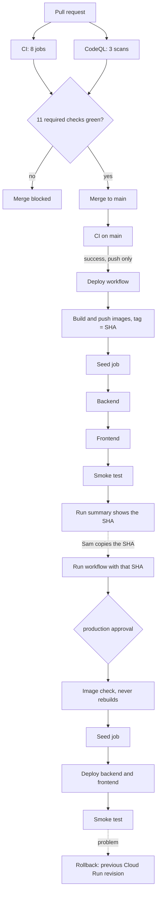

# CI/CD: from pull request to production

## Summary

Every pull request and every push to `main` runs the tests automatically: eight CI jobs and three CodeQL scans. A repository ruleset blocks a merge into `main` until all eleven checks are green. When CI passes on `main`, the site deploys to **dev** with no manual step. **Production** is a manual promotion of the same images dev already ran, and it waits for an approval.

## The pipeline

Rollback is a side path: it is done by hand, on either environment, and does not pass through the pipeline (see [Rollback](#rollback)).

## Triggers

| Workflow | Events | What runs |
|---|---|---|
| `ci.yml` (CI) | push to `main`, every pull request, manual dispatch | 8 jobs: `lint`, `contract`, `hooks-and-ops`, `backend-unit`, `integration`, `audit`, `frontend`, `compose-smoke` |
| `codeql.yml` (CodeQL) | push to `main`, pull requests to `main`, weekly (Tuesday 03:47 UTC) | 3 scans: Python, JavaScript/TypeScript, GitHub Actions |
| `deploy.yml` (Deploy) | CI finishes on `main` (`workflow_run`), manual dispatch with a `sha` | `deploy-dev` after CI; `promote-production` on dispatch |

Neither CI nor CodeQL has path filters or job-level `if:`, so every required check runs on every pull request. `deploy.yml` never runs on a pull request.

## Gates

What stops a bad change, in order:

1. **Required checks on the ruleset.** The ruleset "Protect main" (no bypass list) requires a pull request, blocks force pushes and deletions, and requires these checks to pass: `lint`, `contract`, `hooks-and-ops`, `backend-unit`, `integration`, `audit`, `frontend`, `compose-smoke`, `analyze (python)`, `analyze (javascript-typescript)` and `analyze (actions)`. No approvals are required (0); the checks are the gate.
2. **Deploy only after a green CI on a push to `main`.** `deploy-dev` runs only if the CI run concluded `success` and was a `push`. A red CI, a cancelled run or a pull request run deploys nothing.
3. **Production needs two things.** A manual dispatch from `main` with a full SHA (the input is trimmed of surrounding whitespace and must be exactly 40 lowercase hex characters), and the approval on the `production` environment, which needs Sam.
4. **Production only gets images dev already ran.** The first production step checks that the backend and frontend images for that SHA exist in the registry. If not, the job fails and nothing is deployed. Production never builds.

## What the smoke test checks

`ops/deploy/smoke-test.sh` runs against the frontend URL after every deploy, in both environments:

- `/api/health` answers (it retries for about two minutes, because a scaled-to-zero service needs a moment) and reports the `snapshot_version` in `data/snapshot/MANIFEST.json` and 5 findings;
- `/` carries the `content-security-policy`, `x-frame-options` and `x-content-type-options` headers;
- `/api/findings/%27` returns 422, and the body has no `input` or `ctx` field, so a rejected value is not echoed back.

A failed check fails the run.

## Builds and artifacts

`deploy-dev` builds the backend and frontend images and pushes them to Artifact Registry (`cfe` repository, `europe-west1`), tagged with the full commit SHA. Dev and production deploy that same tag: the image production runs is the one dev ran. A cleanup policy (set in `ops/deploy/gcp-setup.sh`) keeps the 10 most recent versions of each image and deletes older ones. A SHA that is older than that can no longer be promoted; the image check fails with a clear message.

## Credentials

- **CI needs no secrets.** It uses the placeholder values from `.env.example` on a throwaway runner.
- **Deploys use Workload Identity Federation.** The job gets a short-lived token as the `cfe-deployer` service account. There are no key files anywhere.
- **Database URLs live only in Secret Manager.** The seed jobs use the owner URL. The backend services use a read-only login, `cfe_api_reader` ([how to check it](deploy.md#check-the-backend-uses-the-read-only-login)).
- Workflow permissions are least privilege: `contents: read` in CI and CodeQL, plus `security-events: write` on the CodeQL job; `id-token: write` and `contents: read` in Deploy.

## Supply chain

- Every action is pinned to a full commit SHA, with the version in a comment.
- Dependabot opens weekly version-update pull requests (at most 3 per ecosystem). Major versions are taken by hand ([details](ci.md#dependabot)).
- Dependabot alerts are on. Dependabot security updates are off by choice; version updates come from `dependabot.yml`.
- The `audit` job fails on a known vulnerability in a locked runtime dependency ([details](ci.md#jobs)).
- CodeQL runs on every pull request and weekly ([details](ci.md#codeql)).
- Secret scanning with push protection is on, and private vulnerability reporting is on.

## Rollback

Cloud Run keeps old revisions. To roll back, route traffic to the previous revision of the service, then move it forward again when the problem is fixed. A rollback does not undo a database seed. The commands are in [deploy.md](deploy.md#roll-back), and a rehearsal on dev is recorded in [Rollback tried on dev](deploy.md#rollback-tried-on-dev).

## Evidence

For commit `f792e09` (pull request #36):

- Dev deploy, run #35, triggered by `workflow_run`, success: <https://github.com/Sanjomwa/clio-findings-explorer/actions/runs/42513223267>
- Production promotion, run #36, triggered by `workflow_dispatch`, approved by Sanjomwa, success: <https://github.com/Sanjomwa/clio-findings-explorer/actions/runs/42513787383>
- After that deploy, every route was loaded on dev and production in both themes, with 0 Content-Security-Policy violations.

Workflow pages: [CI](https://github.com/Sanjomwa/clio-findings-explorer/actions/workflows/ci.yml), [CodeQL](https://github.com/Sanjomwa/clio-findings-explorer/actions/workflows/codeql.yml), [Deploy](https://github.com/Sanjomwa/clio-findings-explorer/actions/workflows/deploy.yml).

## What it does not do (by design)

- **No automatic production deploy.** A person picks the SHA and approves.
- **No preview environment per pull request.** There are two environments, dev and production.
- **Coverage is reported, not enforced.** The test jobs print a coverage table; nothing fails on a threshold.
- **The deploy workflow does not run on pull requests.** Only a green `main` reaches dev.

## Where the detail is

- [docs/ci.md](ci.md): each CI job, CodeQL and Dependabot, and how to reproduce each check locally.
- [docs/deploy.md](deploy.md): the one-time cloud setup, the promotion steps, rollback commands and costs.
